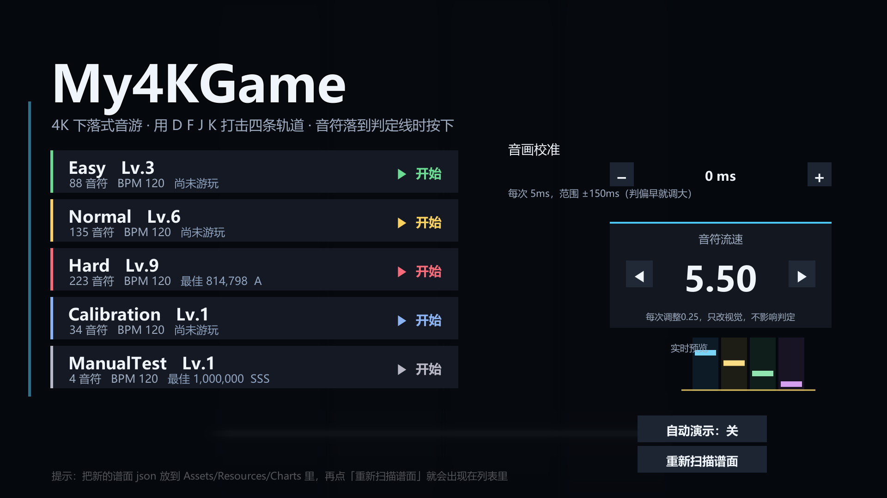
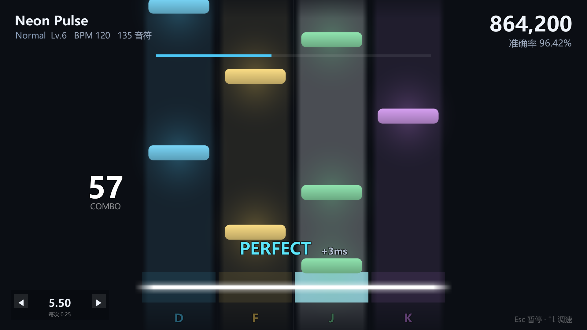

# My4KGame —— 4K 下落式音游（Unity 2022.3.62f3c1）

> 按《Unity 4K 音游制作手册》做，并且把它**做完了**。
> 手册第 4 章那四个脚本（NoteData / GameManager / NoteController / NoteSpawner）一个不少，
> 在此基础上补齐了"能当作品交出去"需要的一切：选曲、五档难度（Easy / Normal / Hard / Expert / Master）、
> 分级判定、连击计分、结算评级、暂停恢复、音画校准、**流速可调（判定不受影响）**、
> **Hold 长按（含持续光效）**、对象池、自动演示、编辑器自检工具、自动化冒烟测试。




> 上面两张图不是手绘的效果图，是工程里的 `My4KGame → 6. 渲染预览图` 用真实场景离线渲染出来的。

---

## 分工说明

这个工程由两个人接力完成，提交记录里也标了作者：

| 阶段 | 负责人 | 内容 |
| --- | --- | --- |
| 前半程 | **Irrar** | 按手册搭完整框架、判定与计分、流速系统、UI 交互修复 |
| 交接 | **Sice54546** | 新增暂停弹窗、结算按钮修复、歌曲选择界面、Hold 长按机制、两首新歌与曲绘 |
| 后半程 | **Irrar** | 修协作方谱面的 Hold 冲突、补 Hold 持续反馈、修界面遮挡、补 Master 难度 |

> 协作方的两次提交 `1652b4c`、`2a0f558` 直接推到了 `main`，
> 之后的 `5b40ed8` 是针对这两次交付做的修复与补强。
> 详细过程见 [`Docs/开发过程与复现.md`](Docs/开发过程与复现.md)。

---

## 一、怎么跑起来（3 步）

| 步骤 | 操作 |
| --- | --- |
| 1 | 双击工程根目录的 **`打开游戏.bat`**（用 Unity Hub 打开 `My4KGame` 文件夹也一样） |
| 2 | 第一次打开要等 2~5 分钟（导入素材、编译脚本）。如果场景是空的，点菜单 **`My4KGame → 1. 一键生成全部`** |
| 3 | 按 Unity 顶部的 **▶ 播放键** → 进入选曲界面 → 点任意难度开始 |

工程里已经导入过一遍（`Library/` 是热的），第二次打开通常几十秒就能进。

> **如果打开 Unity 看到的是空白场景**（标题写着 `Untitled`，Game 视图里只有蓝天和灰地面），
> 说明游戏场景没被打开，按 ▶ 自然什么都不会发生。三种解法任选：
> ① 双击 Project 面板 → `Assets/Scenes/My4KGame`；
> ② 菜单 `My4KGame → 0. 打开游戏场景`；
> ③ 什么都不做 —— 工程里的 `AutoOpenGameScene` 脚本会在编辑器加载完成后自动跳过去，
> 并把「播放模式启动场景」设为它，以后在哪个场景按 ▶ 都会进游戏。

**按键**

| 键 | 作用 |
| --- | --- |
| `D` `F` `J` `K` | 四条轨道，从左到右 |
| `Esc` | 游玩中暂停 / 暂停中继续 / 结算界面回选曲 |
| `↑` `↓` | **实时调整音符流速**（每次 ±0.25） |
| `PageUp` `PageDown` | 流速一次调 1.00 |
| 鼠标 | 选曲、音画校准（− / +，每次 5ms）、流速（卡片上的 ◀ / ▶）、开关自动演示 |

---

## 二、判定与计分规则

| 判定 | 窗口 | 计分系数 | 说明 |
| --- | --- | --- | --- |
| PERFECT | ±40 ms | 1.0 | 接近"同时性知觉阈"，人和声音感觉是同时的 |
| GREAT | ±80 ms | 0.7 | 还在有意识精确控制的范围内，但已能听出先/后 |
| GOOD | ±120 ms | 0.4 | 接近运动反应的固有抖动下限，再放宽判定就没有区分度了 |
| MISS | 超过判定线 140 ms 没按 | 0 | 超过这个值玩家自己都知道按错了 |

- **总分 1,000,000** = Σ(单音符基础分 × 判定系数)，基础分 = `1,000,000 / 谱面音符数`
- **准确率** = Σ判定系数 / 已判定音符数；评级看准确率：SSS ≥ 98% / SS ≥ 95% / S ≥ 90% / A ≥ 80% / B ≥ 70% / C ≥ 60% / D
- **连击**：PERFECT/GREAT/GOOD 都续连，MISS 断连
- 分数和准确率分开统计：分数会被谱面音符数稀释，准确率只反映手感，两个一起看才知道是"打得好"还是"歌简单"

### 流速可调，但判定一点不变

- **主界面**：右边一张**卡片**，中间是大字号数值 `5.50`，左右 `◀` `▶` 各调 0.25，卡片下方是实时的下落预览。
- **游戏内**：左下角一个半透明悬浮窗 `◀ 5.50 ▶`，随时快速调；也可以用键盘 `↑` `↓`（0.25）/ `PageUp` `PageDown`（1.00）。
- **数值范围固定 1.00 ~ 10.00，步长 0.25**；`5.50` 对应原来的手感（×1.00）。
- **两边共用同一个全局状态**（`ScrollSpeedState`）：主界面改完进歌直接生效，游戏内改完回主界面也会同步；每次改动都写进 `PlayerPrefs`，下次打开还在。

| 数值 | 1.00 | 3.00 | 5.50（默认） | 8.00 | 10.00 |
| --- | --- | --- | --- | --- | --- |
| 视觉系数 | ×0.25 | ×0.46 | **×1.00** | ×2.16 | ×4.00 |
| 一屏时间 | 8.00s | 4.32s | **2.00s** | 0.93s | 0.50s |

> 映射是等比的：`系数 = 2 ^ (2 × (数值 − 5.50) / 4.50)`。
> 每按一次（0.25）快 **8%**，按一次 `PageUp`（1.00）快 **36%** —— 一格就能看出来。

按钮下面还有一个**实时预览**小窗：四个迷你音符按当前流速循环下落，
按下 `+` 的瞬间就能看到变快，不用真开一局去试。

| 只受流速影响 | 完全不受流速影响 |
| --- | --- |
| 音符的屏幕 Y 位置（`ScrollSpeedTrack.SecondsAheadToY`） | `NoteData.JudgeTimeMs`（谱面加载时烘一次，之后不可变） |
| 音符的出场提前量（`TravelSeconds = 2.0 / 系数`） | 判定窗口 40 / 80 / 120 / 140 ms |
| 调速时的平滑过渡（0.12s） | 判定结果（只比较"按键时间 − 判定时间戳"） |

代码上是一条硬边界：判定链路（`NoteSpawner.ResolvePress` → `GameManager.JudgeMs`）只接受毫秒误差，
既拿不到 `ScrollSpeedTrack`，也从不读 `transform.position`；
而 `ScrollSpeedTrack` 干脆不认识 `NoteData` 和判定窗口。

> 详细架构、数据结构、映射公式、8 项验收对照和实测输出，见
> [`Docs/流速与判定解耦说明.md`](Docs/流速与判定解耦说明.md)。
> 想把工程拿到自己电脑上跑、或者一起改，见 [`Docs/协作指南.md`](Docs/协作指南.md)。
> 想看这个工程是怎么一步步做出来的（含对话节选、每步验证数据、复现步骤），见 [Docs/开发过程与复现.md](Docs/开发过程与复现.md)。
> 自动化验证：菜单 `5. 自检`（无头 5 项）+ 菜单 `9. 冒烟测试`（真跑三档流速各一局）。

---

## 三、和手册的对应关系

| 手册 | 手册给出的东西 | 本工程里的位置 |
| --- | --- | --- |
| 2.2 判定线 / 四条轨道 | JudgeLine、Lane0~3、`Y=-4`、`X=±3.75/±1.25` | `Assets/Scripts/Core/PlayfieldLayout.cs`（常量）+ `WorldBuilder.cs`（生成同名物体，数值完全一致） |
| 3. 音频时间 dspTime | 用 `AudioSettings.dspTime` 当主时钟 | `Assets/Scripts/Core/GameManager.cs` 的 `CurrentAudioTime` |
| 4.1 音符数据 | `NoteData` | `Assets/Scripts/Chart/NoteData.cs`（另加 `ChartData` 装整张谱面） |
| 4.2 游戏管理器 | `GameManager` | `Assets/Scripts/Core/GameManager.cs` |
| 4.3 音符控制器 | `NoteController` | `Assets/Scripts/Gameplay/NoteController.cs` |
| 4.4 音符生成器 | `NoteSpawner` | `Assets/Scripts/Gameplay/NoteSpawner.cs` |
| 5.1 音符预制体 | Note（Scale 2 × 0.5） | `Assets/Resources/Prefabs/Note.prefab`（贴图本身就是 200×50px，所以 Scale 是 1） |
| 5.2 管理器 / Spawner | GameManager + AudioSource、Spawner | `Systems`（GameManager + AudioSource）、`NoteSpawner` 两个物体 |
| 6.1 测试谱面 | `test.json` 四个音符 | `Assets/Resources/Charts/ManualTest.json`（内容一模一样） |
| 第 7 章 排错 | 常见坑 | 见本文最后一节 |

**目录结构**

```
My4KGame/
├── Assets/
│   ├── Editor/
│   │   ├── ProjectBuilder.cs          # 菜单 1~7：贴图/预制体/场景/自检/预览图/一键生成
│   │   └── PlayModeSmokeTest.cs       # 菜单 9：真的跑一局，自动按 D F J K 验证判定
│   ├── Resources/
│   │   ├── Art/                       # 6 张界面贴图（代码画出来再存成 png，可直接替换）
│   │   ├── Audio/NeonPulse.wav        # 72 秒 120BPM 原创练习曲
│   │   ├── Charts/                    # 5 张谱面 json
│   │   └── Prefabs/Note.prefab        # 音符预制体
│   ├── Scenes/My4KGame.unity          # 完整层级：My4KGame / Main Camera / Playfield / Systems / UIRoot
│   └── Scripts/
│       ├── Chart/    NoteData、ChartLibrary、Judgement
│       ├── Core/     GameManager、ScoreSystem、PlayfieldLayout、SaveData、WorldBuilder、GameBootstrap
│       ├── Gameplay/ NoteController、NoteSpawner
│       ├── Presentation/ SpriteFactory、LaneView、PlayfieldView、HitEffect、HitEffectPool
│       └── UI/       UiFactory、HudView、MenuView、ResultView、UiFontBinder
├── Docs/                # 预览图 + 冒烟测试报告
├── tools/               # make_assets.py（生成音乐和谱面）、compile_check.py（离线编译检查）
└── 打开游戏.bat
```

---

## 四、比手册多做了什么（以及为什么）

手册的原型能跑通，但直接用来玩会发现几个问题。下面每一条都是**改掉了一个真实的坑**，
不是"加功能"，答辩/报告里可以直接写。

### 1. 判定从"每个音符自己读按键"改成"扫描式判定"

手册 4.3 里，每个音符在 `Update()` 里自己调 `Input.GetKeyDown(keys[lane])`。
同一轨道连着两个音符时，**一次按键会被两个音符同时吃掉**：判定两次、加两次分、连击涨两点。

本工程改成 `NoteSpawner.ResolvePress(lane, pressTime)`：
一次按下，只在同轨道、且在判定窗口内的音符里挑**离这次按键最近的那一个**，其余不动。
（`Assets/Scripts/Gameplay/NoteSpawner.cs`）

### 2. 对象池，而不是 Instantiate / Destroy

手册用 `Instantiate` + `Destroy`。一首 223 音符的 Hard 谱面在两分钟里会制造几百个死对象，
GC 回收时掉一帧 —— 而**掉一帧就会让歌曲时间和画面错开 16ms**，PERFECT 窗口只有 ±40ms，
一次卡顿就吃掉 40% 的容错。本工程用对象池（`NoteSpawner._pool`、`HitEffectPool`），
一首歌全程只有十几个 GameObject 在复用。

### 3. 判定时间和画面时间分开

- **判定**用原始 `dspTime`（最准，但有约 20ms 的台阶感）
- **画面**用平滑后的 `SongTime`（每帧向真实值收敛 30%，偏差超 30ms 直接吸附）

这是"准确性"和"视觉舒适度"的经典权衡：判定要准，画面要顺，两者解耦最省事。

### 4. 暂停后恢复，歌曲时间不能跳

`dspTime` 是硬件时钟，暂停期间它照常在走。
如果只是 `Pause()/UnPause()`，恢复时歌曲时间会突然多出"暂停了多久"。
正确做法是把起播时刻 `dspSongStart` **整体后移暂停时长**（`GameManager.Resume()`）。
冒烟测试里专门验了这一条："暂停期间歌曲时间冻结""恢复后歌曲时间继续前进"。

### 5. 每帧 `new KeyCode[]` 的隐藏开销

手册 4.3 在 `Update()` 里 `KeyCode[] keys = { D, F, J, K };` —— 每帧每个音符都分配一个数组。
本工程把键位放成 `GameManager.keys` 字段，只在按键时遍历一次。

### 6. 谱面坏数据不会让游戏崩

`ChartLibrary.Parse()` 会丢掉轨道号越界、时间为负、重复的音符，并把问题写进警告，
而不是抛异常或让音符飞到屏幕外。

---

## 五、几个值得讲的设计点

**音频时钟为什么必须是 dspTime**
`Time.deltaTime` 跟渲染帧绑定。一帧 60FPS = 16.7ms，掉一帧就一次性偏差 16.7ms，
PERFECT 窗口 ±40ms 直接吃掉 42%。`AudioSettings.dspTime` 由声卡采样时钟驱动，
单调、稳定、和帧率无关，精度在 1ms 以下。

**提前安排起播**
`musicSource.PlayScheduled(dspTime + leadIn)`：把"从调用到真出声"的延迟交给音频系统自己处理，
我们拿到一个**精确已知的起播时刻**。副作用很优雅 —— 起播前歌曲时间是负数，
倒计时、前奏、谱面前两秒共用一条时间轴，不用写第二套逻辑。

**视觉前馈**
音符不是"到判定线才出现"，而是提前 `travelTime = 2.0s` 从屏幕外开始下落。
给玩家足够的前馈时间去准备动作，而不是等最后一刻才反应。

**反馈要在一帧内**
按下的当帧轨道直接给满亮度，之后 7/s 衰减回去；判定线同时脉冲一下。
按键到画面亮起如果超过 50ms，玩家就会觉得"不跟手"。

**音画校准**
音频输出有 10~50ms 的缓冲延迟，每个人的声卡不一样。菜单右侧的滑条可以实时调
（-150~+150ms，会存到 PlayerPrefs）。校准值作用在判定时间上：
`JudgeTime = CurrentAudioTime - calibrationOffset`。

---

## 六、谱面格式：怎么写自己的歌

放到 `Assets/Resources/Charts/` 下，**文件名就是选曲界面里的谱面名**。两种写法都支持。

### 写法 A：手册第 6 章的纯数组（够用，最简单）

```json
[
  {"time": 2.0, "lane": 0},
  {"time": 3.0, "lane": 1},
  {"time": 4.0, "lane": 2},
  {"time": 5.0, "lane": 3}
]
```

### 写法 B：带元数据（推荐，会显示曲名/BPM/难度）

```json
{
  "songName": "Neon Pulse",
  "audio": "NeonPulse",
  "bpm": 120.0,
  "difficulty": "Normal",
  "level": 6,
  "offset": 0.0,
  "notes": [
    {"time": 2.000, "lane": 0},
    {"time": 2.500, "lane": 1}
  ]
}
```

| 字段 | 含义 |
| --- | --- |
| `time` | 音符**到达判定线**的时间（秒，从歌曲第 0 秒算） |
| `beat` | 可选：用拍定位（第 0 拍 = 歌曲第 0 秒）。填了它就以拍为准，`time` 会被算出来 |
| `lane` | 0~3，从左到右 |
| `audio` | `Assets/Resources/Audio/` 下不带后缀的文件名 |
| `offset` | 整张谱面平移（秒），正值 = 所有音符往后挪 |
| `bpmChanges` | 可选：`[{"beat":16,"bpm":150}]` 这样的变速表，加载时按段落积分成毫秒 |
| `difficulty` / `level` | 显示用（Easy / Normal / Hard / Expert / Master / 自定义，level 数字越大排越后） |

> 用 `beat` 写谱的好处：改 BPM 不用重算时间。换算只在加载时做一次，
> 结果烘进 `NoteData.JudgeTimeMs`，之后调速、暂停都不会动它。

### 操作步骤

1. 把音乐（`.wav` / `.mp3` / `.ogg`）丢进 `Assets/Resources/Audio/`
2. 写一个 json 丢进 `Assets/Resources/Charts/`，`audio` 填音乐文件名
3. 回 Unity，等它导入完；游戏里点菜单右侧的 **「重新扫描谱面」**（不用重启）
4. 不想手写时间？按 BPM 算：`time = 拍号 × 60 / BPM`。120 BPM 时每拍 0.5 秒

> 自带的 5 张谱面就是这么生成的：`tools/make_assets.py`（纯 numpy 合成，无版权问题）。
> 想重新生成：`python tools/make_assets.py --force`

---

## 七、自带内容

| 资源 | 说明 |
| --- | --- |
| `NeonPulse.wav` | 72 秒、120 BPM、Am-F-C-G 进行的原创电子练习曲（36 小节，五段结构：前奏→鼓→和弦→高潮→收尾） |
| `NeonPulse_Easy.json` | 88 音符，四分音符为主，适合第一次上手 |
| `NeonPulse_Normal.json` | 135 音符，八分音符 + 少量双押 |
| `NeonPulse_Hard.json` | 223 音符，八分连打 + 双押 + 交替 |
| `NeonPulse_Master.json` | 411 音符 / 5.87 音符每秒，16 分加密，几乎无空档 |
| `NeonPulse_Calibration.json` | 34 个音符，每秒一个、四轨轮转，用来确认自己的手感/延迟 |
| `WorldsEndBLACKBOX_*.json` | 205 BPM，Easy 114 / Normal 179 / Hard 275 / Expert 442 / **Master 1245（7.98 音符每秒）** |
| `InYourBlueEyes_*.json` | 145 BPM，Easy 113 / Normal 189 / Hard 331 / Expert 423 / **Master 1374（6.43 音符每秒）** |
| `ManualTest.json` | 手册第 6 章那个 4 音符测试谱面 |

> Master 难度由 `tools/make_master.py` 生成：以同曲 Expert（Neon Pulse 用 Hard）的时间戳为**采音锚点**，
> 按 16/8 分网格加密、局部密度封顶、并保证任何空档 ≤ 600ms —— 即"全程没有空白休息段"。
> 觉得太简单就改脚本顶部的 `nps` 重新生成。

音乐和谱面是同一个脚本按同一套节拍表生成的，所以**音符一定踩在鼓点上**，不会出现"谱面和音乐对不上"。

---

## 八、编辑器工具（菜单 `My4KGame`）

| 菜单 | 作用 |
| --- | --- |
| 0. 打开游戏场景 | 打开 `Assets/Scenes/My4KGame.unity`（按 ▶ 就能玩的那个场景） |
| 1. 一键生成全部 | 贴图 + 预制体 + 场景，一条龙（新克隆的工程点这个） |
| 2. 只生成贴图 | 把代码画的 6 张图写成 `Assets/Resources/Art/*.png`，之后可以用画图软件直接替换 |
| 3. 重新生成音符预制体 | 重建 `Note.prefab` |
| 4. 重新生成游戏场景 | 重建 `My4KGame.unity` 并加入 Build Settings |
| 5. 自检 | 检查贴图/预制体/场景/谱面/音频/引用/判定窗口/计分公式/谱面解析，结果打到 Console |
| 6. 渲染预览图 | 离线渲染 `Docs/preview_menu.png`、`Docs/preview_play.png`（不用按播放） |
| 7. 播放 | 打开场景并直接进播放模式 |
| 9. 冒烟测试 | 真的跑一局：自动按 D F J K、测空打、测暂停恢复、走到结算，结果写进 `Docs/smoke_result.txt` |
| 10. 清空成绩纪录 | 清掉所有最佳分数和音画校准值（自动化测试会在 ManualTest 上留一条 1,000,000 的纪录，想干净就从这里清） |

命令行也能跑（CI 友好）：

```powershell
& "C:\Program Files\Unity\Hub\Editor\2022.3.62f3c1\Editor\Unity.exe" `
  -batchmode -projectPath "<工程路径>" `
  -executeMethod My4KGame.EditorTools.ProjectBuilder.BuildFromCommandLine `
  -logFile "<工程路径>\Logs\verify.log"
```

另外 `tools/compile_check.py` 可以不打开 Unity、直接用 Unity 自带的 Roslyn 编译一遍，
几秒钟拿到精确的报错（比等编辑器转圈快得多）。

---

## 九、验收结果

### 自检（菜单 5 / 批处理）

```
[OK] 贴图 6 张齐全            [OK] 音符预制体结构正确（NoteController + Body + Glow）
[OK] 场景存在：Assets/Scenes/My4KGame.unity
[OK] 主相机 / GameManager / NoteSpawner / PlayfieldView / HudView / MenuView / ResultView
[OK] 轨道 4 条就位，判定线已连接
[OK] 5 张谱面全部可解析，音频全部就位，末音符都在音频长度之内
[OK] 判定窗口 PERFECT ±40ms / GREAT ±80ms / GOOD ±120ms / MISS > 140ms
[OK] 判定函数各档结果正确
[OK] 计分与评级逻辑正确（全 Perfect = 1,000,000 / 全 Great = 700,000 / 连击会断）
[OK] 谱面解析：支持纯数组、能过滤坏音符、空谱面会报错
```

### 冒烟测试（菜单 9，真的跑一局）

`Docs/smoke_result.txt` 的摘要：

```
[OK] 倒计时结束后进入 Playing
[OK] 附近没有音符时按键判空打（Judgement.None）→ 空打不加分
[OK] Pause() → 暂停期间歌曲时间冻结 → Resume() → 恢复后时间继续前进
[OK] 4 次按键全部命中音符（空打 0 次），4 个音符都被判定，没有 MISS
[OK] 结算分数 1,000,000，评级 SSS，结算后歌曲时钟已停
[OK] EnterMenu() 回到选曲，自动演示也能正常打中音符
结论：通过
```

---

## 十、常见问题（对照手册第 7 章）

| 现象 | 原因与解决 |
| --- | --- |
| 点了播放，谱面里没有音符掉下来 | 谱面 `audio` 名字对不对；`time` 是不是比 `travelTime`(2s) 还小；菜单里点「重新扫描谱面」 |
| 音符掉下来但按键没反应 | 检查 `GameManager` 的 `keys` 是不是 4 个；Unity 的 `Project Settings → Player → Active Input Handling` 要是 `Both` 或 `Input Manager (Old)` |
| 音符位置和判定线对不上 | 全部数值都在 `PlayfieldLayout.cs`：`JudgeLineY=-4`、`SpawnY=6`、`travelTime=2`。改一处就全改，不用到处找 |
| 没有声音 | `Assets/Resources/Audio/` 下有没有这个文件；`ChartData.audio` 是否同名（不带后缀） |
| 中文显示成方块 | 界面字体是从系统里取的中文字体（`Microsoft YaHei` 等），`UiFontBinder` 会负责绑定。系统里没有中文字体就会退回英文 |
| 重新打开工程后界面文字消失 | 这是 Unity 的已知行为（动态字体不是工程资源）。`UIRoot` 上的 `UiFontBinder` 会在场景加载时自动重新绑一次，不影响运行 |
| 按下去总觉得判定偏早/偏晚 | 菜单右侧「音画校准」滑条，调完自动保存 |
| 想换成自己的美术 | 替换 `Assets/Resources/Art/` 下的同名 png 即可，代码会自动优先用图片资源；删掉也能跑（会用代码现场画） |

---

## 十一、已知取舍（想继续做可以从这些入手）

- **没有长按（Hold）音符**：数据结构和判定都已经按"一击一判"设计，加 Hold 需要给 `NoteData` 加 `duration`，并让 `NoteController` 维护按下-按住-松开三个状态
- **没有变速（BPM 变化）谱面**：目前一秒=一秒，所有时间都是绝对时间；要支持变速得引入"拍号 ↔ 秒"的映射表
- **没有谱面编辑器**：现在靠 `tools/make_assets.py` 的图案表生成，或者手写 json
- **打包**：工程已经配好 1920×1080 窗口化 + 场景在 Build Settings 第一位，装了 Windows Build Support 就能直接 `File → Build`
- 可以继续加：判定偏移统计图（打完给一条"你总是偏早 12ms"的曲线）、osu! 谱面转换脚本、WebGL 版、多难度排行榜
